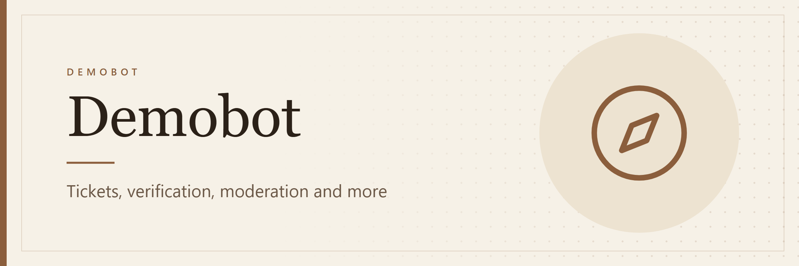

# Demobot

An all-in-one Discord bot for community servers: support tickets, verification, moderation, role menus, giveaways, suggestions, applications and a staff dashboard. Built with Discord.js v14 on Node 24.

Every panel uses Discord's newest message layout, **Components V2**, with custom banner images. The only runtime dependency is `discord.js`. Storage, config loading and tests all use built-in Node features.

## Screenshots

| Help | Verification |
| --- | --- |
| 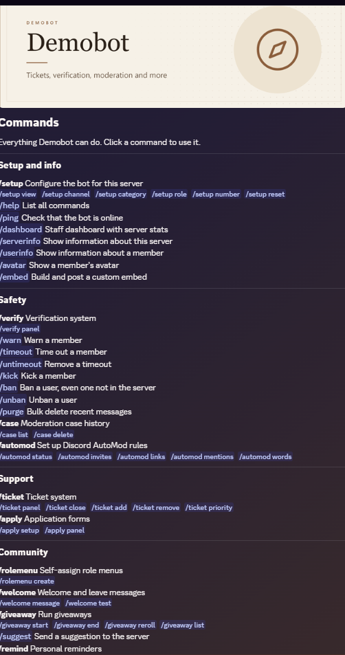 | 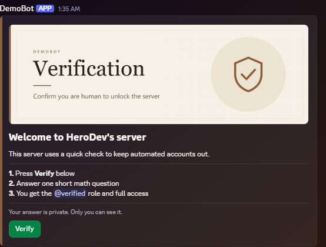 |
| **Ticket panel** | **Ticket** |
| 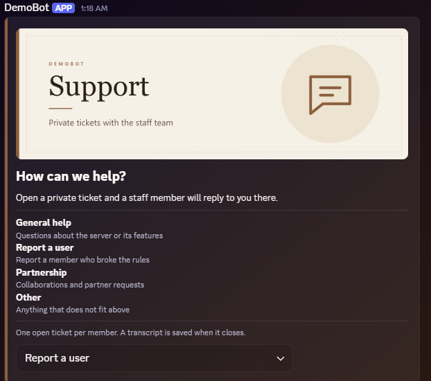 | 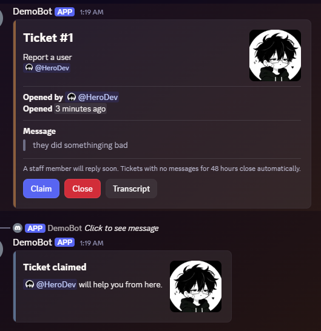 |
| **Staff dashboard** | **HTML transcript** |
| 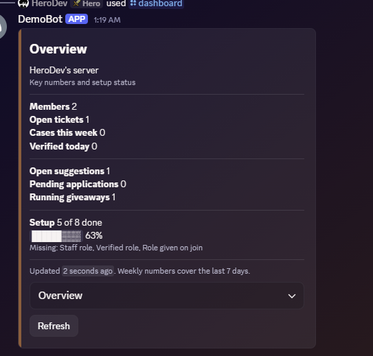 | 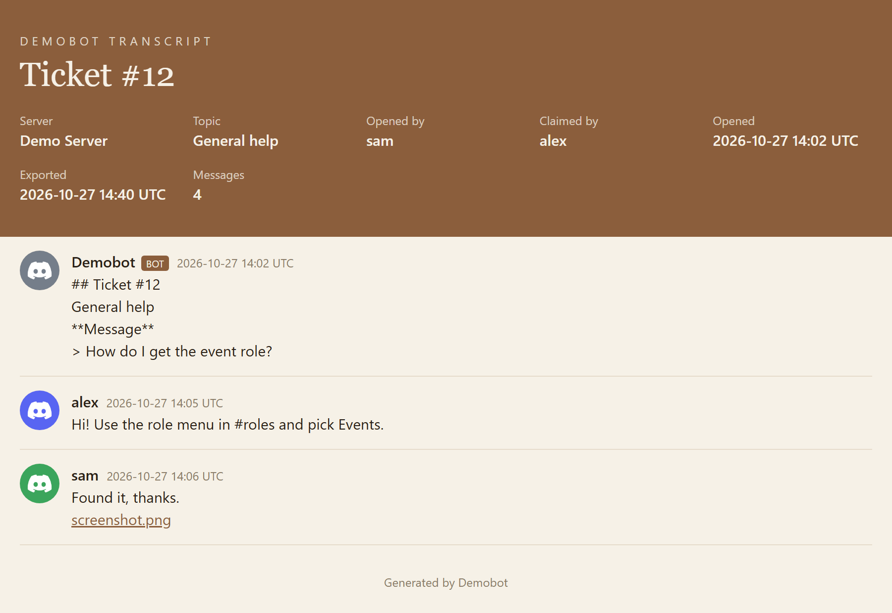 |
| **Moderation case** | **Server logs** |
| 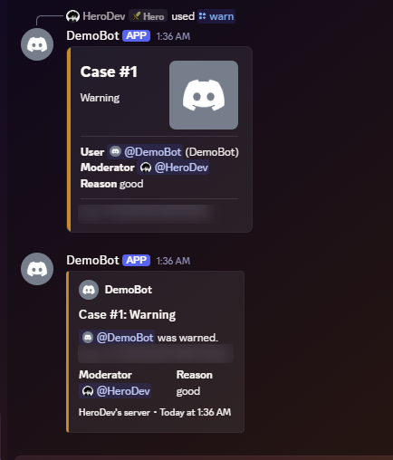 | 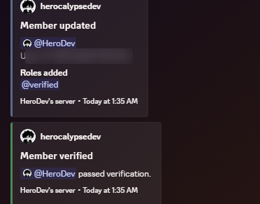 |
| **Giveaway** | **Suggestion** |
| 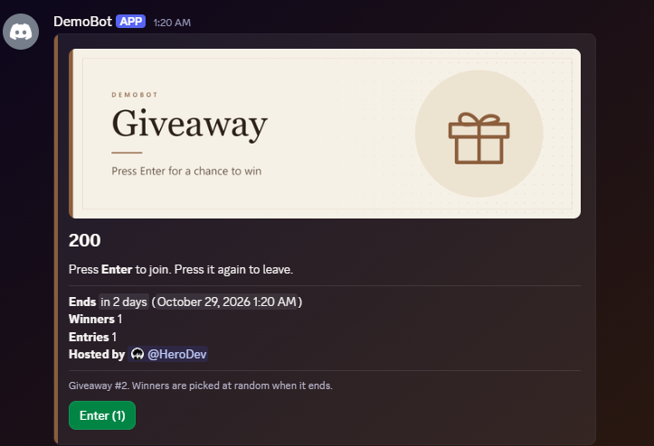 | 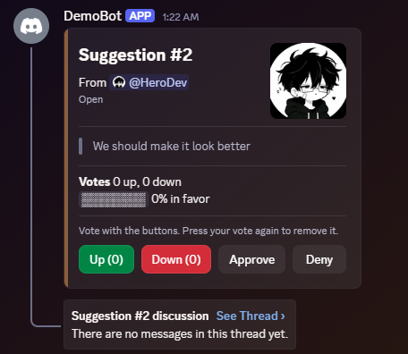 |
| **Applications** | **Welcome card** |
| 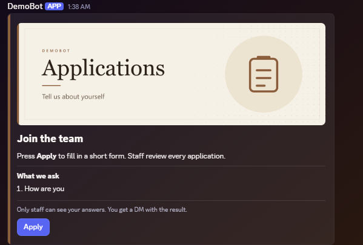 | 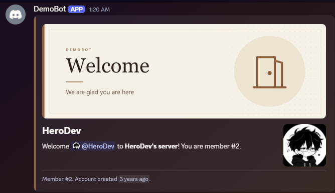 |

## Features

**Support tickets**
- Panel with a topic menu (General help, Report a user, Partnership, Other). A pop-up asks for the reason.
- Private ticket channel per member, visible only to the member and staff. Limit of one open ticket per member.
- Claim, Close (with confirmation) and Transcript buttons. Staff can add or remove members and set priority, which renames the channel.
- On close: an HTML transcript goes to the log channel and the member's DMs, followed by a 1 to 5 rating.
- Tickets with no messages for 47 hours get a warning and close one hour later.

**Verification**
- Verify button opens a math captcha pop-up. The answer is kept in memory, never in the button data a client could read.
- Optional minimum account age. Three wrong answers in 10 minutes lock the member out for 10 minutes.
- Every attempt is logged and counted for the dashboard.

**Moderation**
- `/warn`, `/timeout`, `/untimeout`, `/kick`, `/ban`, `/unban`, `/purge`.
- Role hierarchy checks for both the moderator and the bot. The member gets a DM before the action. Every action becomes a numbered case.
- Paged case history per member.
- Server logs: message edits and deletes, joins (new accounts flagged), leaves, role and nickname changes.
- `/automod` sets up Discord's native AutoMod rules (invite links, all links, mention spam, blocked words). Discord enforces them even while the bot is offline.

**Community**
- Self-assign role menus, with an option to allow only one role. Roles with staff permissions are refused.
- Welcome and leave cards with a banner, avatar and custom text (`{user} {name} {server} {count}`). Autorole on join.
- Giveaways with an Enter button, live entry count, random winners (crypto RNG), end early and reroll. Giveaways survive restarts.
- Suggestions with up and down votes, an approval bar, a discussion thread and staff approve or deny with a reason.
- Personal reminders by DM, with a channel fallback when DMs are closed.

**Staff tools**
- Application forms with up to 5 questions. Staff accept or deny in a review channel, and accepting can give a role.
- Embed builder through a pop-up, with a preview before posting.
- `/dashboard`: open tickets, average time to claim, satisfaction rating, top staff, cases this week, verification pass rate, setup progress.
- `/serverinfo`, `/userinfo` (with profile banner), `/avatar` (with download links).

## Commands

| Area | Commands |
| --- | --- |
| Setup | `/setup view` `/setup channel` `/setup category` `/setup role` `/setup number` `/setup reset` `/help` `/ping` |
| Tickets | `/ticket panel` `/ticket close` `/ticket add` `/ticket remove` `/ticket priority` |
| Verification | `/verify panel` |
| Moderation | `/warn` `/timeout` `/untimeout` `/kick` `/ban` `/unban` `/purge` `/case list` `/case delete` `/automod` |
| Community | `/rolemenu create` `/welcome message` `/welcome test` `/giveaway start` `/giveaway end` `/giveaway reroll` `/giveaway list` `/suggest` `/remind set` `/remind list` `/remind cancel` |
| Staff tools | `/apply setup` `/apply panel` `/embed` `/dashboard` `/serverinfo` `/userinfo` `/avatar` |

Most staff commands are hidden from members without the matching Discord permission. Ticket staff actions, suggestion and application reviews and the dashboard also accept the staff role set with `/setup role`.

## How it is built

- **Discord.js v14**: slash commands, buttons, select menus, pop-up forms (modals) and Components V2 containers, sections, thumbnails, media galleries and file components.
- **`node:sqlite`** for storage. One file in `data/`, created on first start, with no native build step.
- **`node --env-file`** for config, so `dotenv` is not needed.
- **`node:test`** for tests, which run against an in-memory database.
- **Banners** are an HTML template rendered to PNG with headless Chrome (`npm run banners`).
- **Safety**: input is checked at every boundary (durations, hex colors, https-only image links, user IDs). Transcripts are HTML-escaped. Role menus refuse roles with staff permissions. Messages only ping the people they are meant for.
- **Reliability**: a single 30-second scheduler handles giveaways, reminders and inactive tickets from the database, so nothing is lost on restart. Every interaction error is caught, reported privately to the user and posted to the log channel.

About 2,300 lines of source and 280 lines of tests.

## Setup

1. Create an application in the [Discord Developer Portal](https://discord.com/developers/applications) and add a bot.
2. Under **Bot**, turn on the **Server Members** and **Message Content** intents. Optionally upload `assets/avatar.png` as the bot avatar.
3. Invite the bot. Replace `YOUR_CLIENT_ID` with your application ID:
   ```
   https://discord.com/oauth2/authorize?client_id=YOUR_CLIENT_ID&scope=bot+applications.commands&permissions=1409017834550
   ```
   Then move the bot's role above every role it should give out or moderate.
4. Install and configure:
   ```
   npm install
   cp .env.example .env
   ```
   Fill in `DISCORD_TOKEN` and `CLIENT_ID`. Set `GUILD_ID` to a test server ID so commands update there right away.
5. Register commands and start:
   ```
   npm run deploy
   npm start
   ```
6. In Discord, run `/setup view` and set the log channel, staff role, ticket category, verified role and the other channels. Then post the panels with `/ticket panel`, `/verify panel`, `/rolemenu create` and `/apply panel`.

Requires Node 24 or newer.

## Hosting

Any host with Node 24 works, for example a Pterodactyl panel such as Wispbyte. Upload the project without `node_modules` and `data/`, let the host run `npm install`, set the start command to `npm start`, and keep `.env` private. Never upload an old `data/demobot.db` over the live one.

Run only one copy per bot token. Two copies answer every interaction twice and split the database.

## Development

```
npm test          # run the tests
npm run deploy    # register slash commands
npm run banners   # re-render assets/banners/*.png after editing assets/banner.html
```

```
src/index.js        client, interaction router, error handling, scheduler
src/deploy.js       slash command registration
src/db.js           SQLite schema and settings helpers
src/util.js         colors, durations, permissions, log channel
src/ui.js           Components V2 card builder and small display helpers
src/modules/*.js    one file per feature
test/*.test.js      tests
assets/             banner template, banners, bot avatar
scripts/banners.js  banner renderer
```

## License

MIT. Made by [HerocalypseDev](https://github.com/HerocalypseDev).
